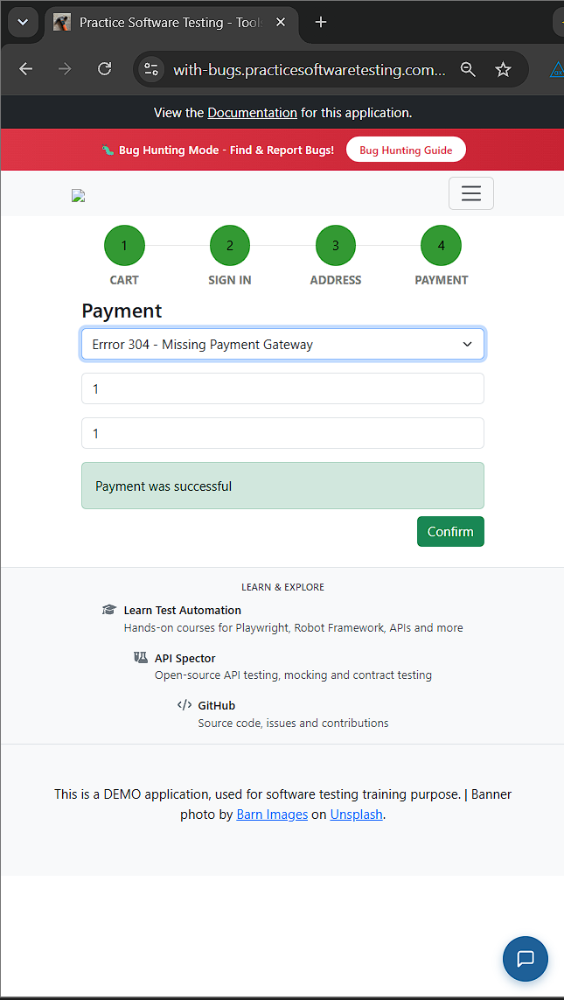
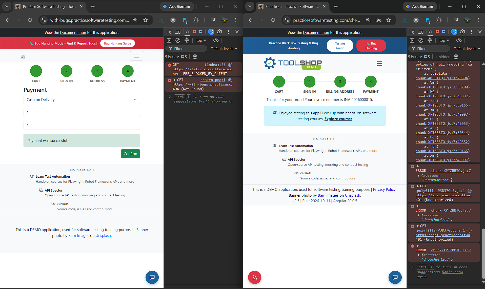

# Session Notes T5 — TC-EXP-01 (Charter 1)

| Field | Nilai |
|---|---|
| Test Case | `TC-EXP-01` — Exploratory, P2 |
| Tester | Ikhsan (R3) |
| Test Lead / Debrief | Atsaal (R1) |
| Tanggal | 21 Oktober 2026, 23:07–23:37 WIB |
| Durasi | 30 menit |
| Browser | Chrome |
| Target | https://with-bugs.practicesoftwaretesting.com |
| Oracle | https://practicesoftwaretesting.com |
| Eksekusi Kiwi | TE-85 — https://localhost/run/31/#c85 |
| Charter | Eksplorasi keranjang dan alur checkout |
| Data uji | Variasi kuantitas, kuantitas ekstrem, billing, metode pembayaran |
| Eskalasi | [#7](https://github.com/SallVea/UTS-PPL/issues/7), [#8](https://github.com/SallVea/UTS-PPL/issues/8) — 2 bug (batas maksimal 2) |
| Session Notes | Lengkap, rasio waktu 100% |

## Session Notes (isi dari Kiwi)

**SESSION NOTES **
Tester   : Ikhsan (R3)
Tanggal  : 21 Okt 2026
Mulai    : 23:07    Selesai: 23:37 (WIB)   Durasi aktual: 30 menit
Target   : with-bugs.practicesoftwaretesting.com
Acuan    : practicesoftwaretesting.com
Browser  : Chrome | Build v2.5 (2026-10-11), Angular 20.0.5

**CHARTER**
Explore keranjang belanja dan alur checkout
With variasi ubah kuantitas, kuantitas ekstrem, pengisian billing,
     pergantian metode pembayaran, dan konfirmasi pembayaran
To discover anomali kalkulasi total harga, freeze pada form,
     atau error JavaScript yang tidak tertangani

**RASIO WAKTU **
Setup : 2 menit = 7%
Test design & execution : 18 menit = 60%
Bug investigation & reporting : 10 menit =  33%
total : 30 menit = 100%

**CATATAN SESI (kronologis)**
[23:07] Kondisi awal beranda.
        Acuan: logo Toolshop tampil, ada banner "Practice Black Box Testing".
        With-bugs: logo rusak (broken.png 404), banner merah
        "Bug Hunting Mode".
        Console with-bugs hanya 2 error (cloudflareinsights diblokir klien
        dan broken.png 404), tidak ada error JS aplikasi.
[23:9] Halaman Cart, 3 item.
        Harga satuan sama di kedua situs.
        With-bugs: kolom Total per baris tampil $00.00,
        acuan menghitung dengan benar.
        Menu header with-bugs: "Contakt" (typo) dan "User Data not found".
[23:11] Ubah kuantitas 1 -> 5 -> 2 -> 4: normal, total sinkron.
        Kuantitas ekstrem: with-bugs maksimum 10, acuan 99 dengan toast
        "You can order at most 99 of this product."
        Total keseluruhan with-bugs benar untuk qty 10 ($1,269.50).
[23:15] Dipastikan with-bugs tidak menampilkan toast apa pun saat qty
        dibatasi ke 10.
[23:17] Qty 5 di semua baris: total sempat $694.80 karena input Pliers
        belum di-commit. Setelah Enter menjadi $634.75, sama dengan acuan.
        Bukan bug. Hipotesis EG-01 (race condition) tidak terbukti pada
        total keseluruhan.
[23:20] Sign In: kedua situs menampilkan "Hello Jane Doe, you are already
        logged in". Header with-bugs tetap "User Data not found".
[23:22] Billing Address.
        With-bugs: judul "Blliling Adress", field tanpa label, isi awal salah
        ("Test street 98", "Vienna", "Austria", "missing value"),
        tidak ada auto-fill, State kosong, tombol lanjut hijau tanpa teks
        (tetap bisa diklik).
        Acuan: judul "Billing Address", field berlabel, Street/City/State
        terisi otomatis setelah Country, Postal code, House number diisi.
[23:24] Payment.
        With-bugs: dropdown punya opsi ke-7 "Errror 304 - Missing Payment
        Gateway". Semua metode hanya menampilkan field Account name dan
        Account number dengan pesan error merah sebelum diisi. Tombol
        bernama "Confirm".
        Acuan: dropdown maksimal sampai Gift Card, field spesifik per metode
        (Bank Transfer: Bank Name/Account Name/Account Number; Credit Card:
        Card Number/Expiration Date/CVV/Card Holder Name; Buy Now Pay Later:
        pilihan cicilan; Gift Card: Gift Card Number/Validation Code;
        Cash on Delivery: tanpa field). Tombol bernama "Check payment".
[23:26] Confirm payment (Cash on Delivery).
        With-bugs: tetap di halaman Payment, hanya muncul "Payment was
        successful". Tidak ada halaman konfirmasi dan nomor invoice,
        stepper tidak berpindah, tombol Confirm masih aktif.
        Acuan: "Thanks for your order! Your invoice number is INV-2026000012."
[23:27-23:37] bug report di github
**TEMUAN**
1. [Critical] Form pembayaran: semua metode memakai field Account name/number
   yang sama dan ada opsi "Errror 304 - Missing Payment Gateway".
   -> Dieskalasi ke GitHub.
2. [Critical] Setelah Confirm payment tidak ada konfirmasi order dan nomor
   invoice. -> Dieskalasi ke GitHub.
3. [Major] Kuantitas dibatasi maksimum 10 tanpa toast (acuan 99 + toast).
   -> Hanya dicatat.
4. [Major] Kolom Total per baris $00.00 di semua kuantitas. -> Hanya dicatat.
5. [Major] Form Billing: tanpa label, data awal salah, tanpa auto-fill,
   tombol tanpa teks, judul typo. -> Hanya dicatat.
6. [Minor] Typo "Contakt", header "User Data not found", logo broken.png 404.
   -> Hanya dicatat, info ke R1.

**PERTANYAAN **
- Double-click tombol Confirm dan pengecekan Order History belum dilakukan.
- Qty 11 dan 100 belum dicoba untuk memastikan batas tepat di 10.
- Refresh dan Back/Forward di alur checkout belum dilakukan.
- Metode selain Cash on Delivery belum sampai tahap Confirm.

## Evidence

## Debrief

Debrief dengan Test Lead dicatat di [SBTM-debrief.md](SBTM-debrief.md). Dua bug Critical (#7 dan #8) dipilih untuk dieskalasi; temuan qty cap 10, total baris $00.00, dan form billing dicatat sebagai observasi karena batas maksimal eskalasi per sesi adalah 2.
