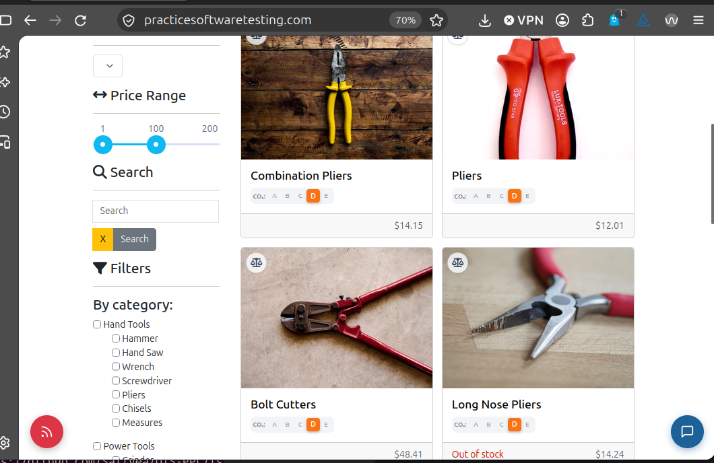
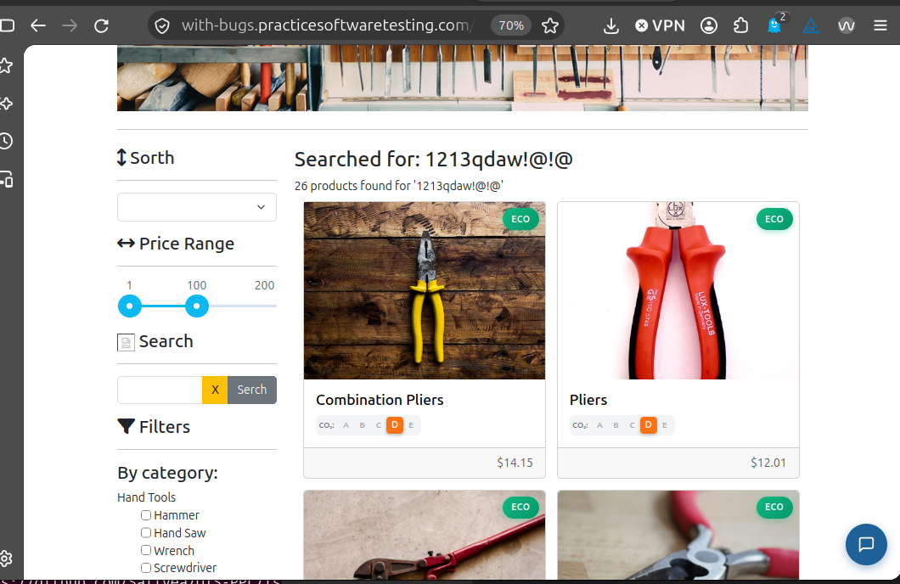
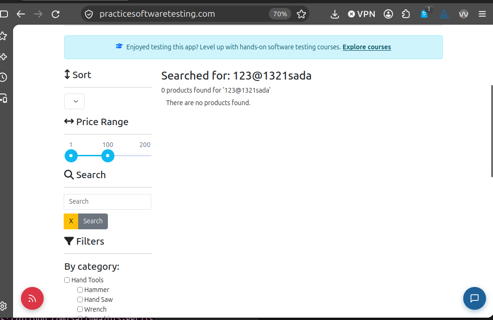
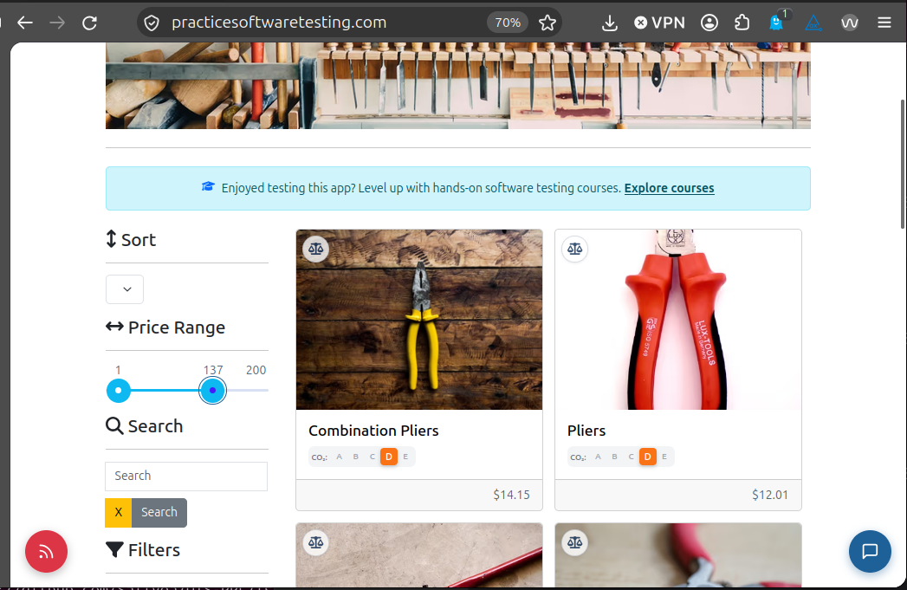
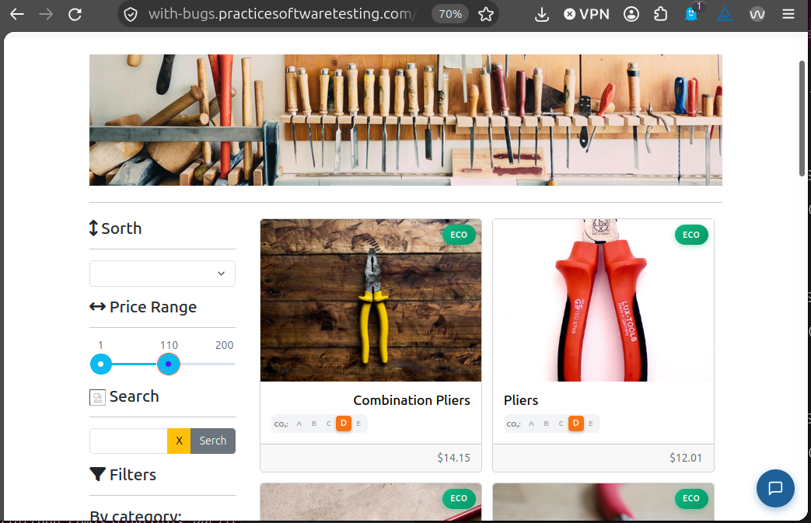

# Session Notes T5 — TC-EXP-02 (Charter 2)

| Field | Nilai |
|---|---|
| Test Case | `TC-EXP-02` — Exploratory, P2 |
| Tester | Atsaal (R1) — cross-role |
| Reviewer / Observer | Ikhsan (R3) |
| Test Lead / Debrief | Atsaal (R1) |
| Tanggal | 22 Oktober 2026, 18:36–19:06 WIB |
| Durasi | 30 menit |
| Browser | Firefox |
| Target | https://with-bugs.practicesoftwaretesting.com |
| Oracle | https://practicesoftwaretesting.com |
| Eksekusi Kiwi | TE-86 — https://localhost/run/31/#c86 |
| Charter | Eksplorasi pencarian katalog, filter harga, dan sesi login/logout |
| Data uji | Keyword ekstrem, filter harga, pengetikan keyword; multi-tab dan URL langsung belum diuji |
| Eskalasi | [#38](https://github.com/SallVea/UTS-PPL/issues/38) — 1 bug (batas maksimal 2) |
| Session Notes | Lengkap, rasio waktu 100% |

## Session Notes (isi dari Kiwi)

SESSION NOTES
Tester : Atsaal (R1)
Tanggal : 22 Okt 2026
Mulai : 18:36 Selesai: 19:06 (WIB) Durasi aktual: 30 menit
Target : with-bugs.practicesoftwaretesting.com
Acuan : practicesoftwaretesting.com
Browser : Firefox

CHARTER
Explore pencarian katalog, filter rentang harga, dan status sesi
login/logout
With manipulasi URL langsung, multi-tab browsing, dan penghentian
sesi mendadak
To discover kebocoran data sesi, hasil pencarian inkonsistensi,
atau broken link pada pagination

RASIO WAKTU
Setup : 7 menit = 23%
Test design & execution : 13 menit = 44%
Bug investigation & reporting : 10 menit = 33%
total : 30 menit = 100%

CATATAN SESI (kronologis)
[18:36-18:43] Setup.
Membuka with-bugs dan acuan berdampingan, menyiapkan browser.
[18:43] Area A, pencarian keyword tanpa hasil.
With-bugs: keyword "1213qdaw!@!@" menampilkan "Searched for:
1213qdaw!@!@" dan "26 products found", semua produk katalog tampil.
Acuan: keyword "123@1321sada" menampilkan "0 products found" dan
"There are no products found."
[18:48] Area A, pengetikan keyword.
With-bugs: saat mengetik keyword, nama produk berubah-ubah.
Acuan: saat mengetik keyword, nama produk tidak berubah-ubah.
[18:52] Area B, filter rentang harga.
Acuan: produk tersaring sesuai rentang (contoh harga 14 memunculkan
Combination Pliers). Judul kartu rata kiri.
With-bugs: saat slider diubah, judul produk rata kanan berpindah
antar kartu (Bolt Cutters pada slider 1-100, Combination Pliers pada
slider 1-110).
[18:56-19:06] Bug investigation & penulisan issue GitHub.

TEMUAN
1. [Major] Pencarian keyword tanpa hasil menampilkan semua produk
(26 products found); acuan menampilkan 0 products.
2. [Minor] Judul kartu rata kanan berpindah saat slider harga diubah.
3. [Minor] Saat mengetik keyword, nama produk berubah-ubah (acuan
tidak).

PERTANYAAN
- Keyword pencarian di dua situs berbeda (with-bugs 1213qdaw!@!@,
acuan 123@1321sada); belum disilangkan atau dicoba keyword nyata
seperti "pliers".
- Batas slider di screenshot berbeda (with-bugs sampai 110, acuan
sampai 137); daftar produk hasil filter belum dibandingkan lengkap.
- Paginasi (halaman 2 dan seterusnya) dan parameter halaman di URL
belum dicoba.
- Area sesi login/logout (multi-tab, Back setelah logout, URL akun
langsung) belum dilakukan.

## Evidence

## Debrief

Debrief dengan Test Lead dicatat di [SBTM-debrief.md](SBTM-debrief.md). Bug Major #38 dipilih untuk dieskalasi; temuan judul kartu tidak stabil dan nama produk berubah saat mengetik dicatat sebagai observasi karena keduanya Minor dan batas maksimal eskalasi per sesi adalah 2.
