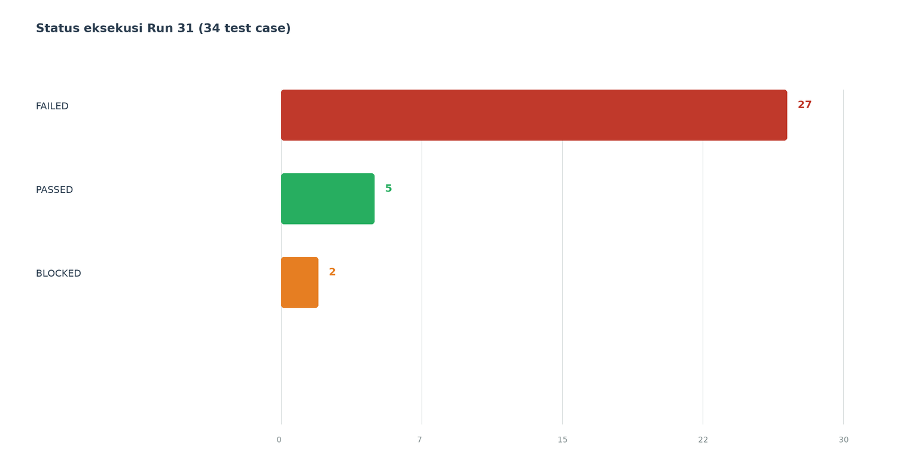
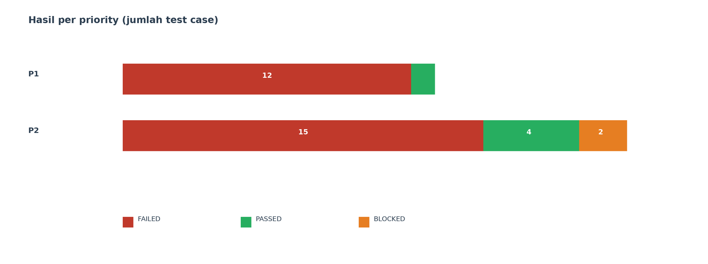
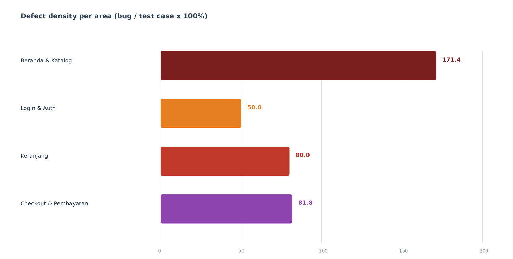
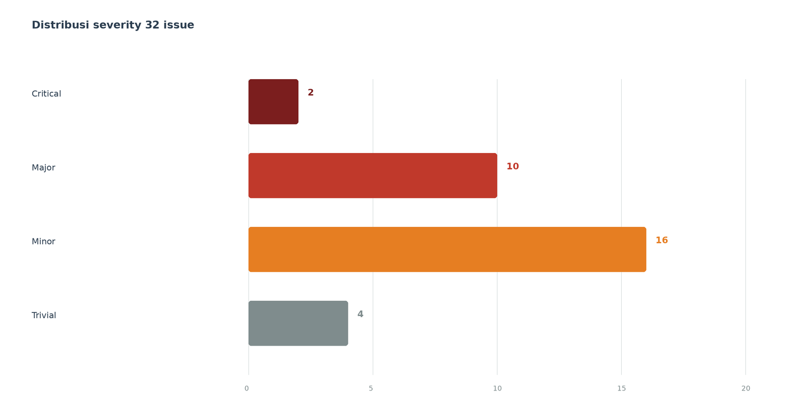

# T9 — Test Execution Summary Report

## CilacapTools Sprint 5 — Build-2024-S5-01

| Field | Keterangan |
|---|---|
| Dokumen | Test Execution Summary Report (T9) |
| Format | Test Execution Summary Report (Modul 2) |
| Posisi | Bab VII — Metrik dan Summary |
| Studi kasus | CilacapTools / Toolshop Sprint 5 |
| Build | `Build-2024-S5-01` |
| Lingkungan | Staging — `https://with-bugs.practicesoftwaretesting.com` |
| Oracle | `https://practicesoftwaretesting.com` |
| Periode eksekusi | 21–25 Oktober 2026 |
| Data per | 25 Oktober 2026 |
| Penyusun | Atsaal (R1 — QA Lead / Test Manager) |
| Repositori | [SallVea/UTS-PPL](https://github.com/SallVea/UTS-PPL) |
| Kiwi TCMS | [Plan 1](https://localhost/plan/1/) (Run 31 konsolidasi + Run 32–47 T6/T7) |
| Keputusan | **NO-GO** |

> **Kesimpulan:** `Build-2024-S5-01` **NO-GO**. Dari 48 test case, 39 FAILED dan 2 BLOCKED; 14 issue Critical/Major masih OPEN.

Dokumen ini merupakan bagian **Bab VII (Metrik dan Summary)** laporan UTS PPL CilacapTools. Seluruh angka dihitung dari Plan 1 dan 34 issue OPEN per 25 Oktober 2026.

## Ringkasan Eksekutif

Plan 1 mengeksekusi **48 dari 48 test case (100%)**. Hasilnya: **7 PASSED, 39 FAILED, dan 2 BLOCKED**. Pass rate hanya **14,6%**, sedangkan 34 issue masih **OPEN** di GitHub: 2 Critical, 12 Major, 16 Minor, dan 4 Trivial.

Quality gate tidak terpenuhi. Seluruh P1 dan P2 wajib PASS, tetapi hanya **1 dari 15 P1** yang PASS dan hanya **6 dari 33 P2** yang PASS. Dua test case P2 juga BLOCKED. Karena itu, rekomendasi T9 adalah **NO-GO** untuk `Build-2024-S5-01`.

**Temuan utama yang memblokir rilis:**

- Checkout tidak menghasilkan invoice dan konfirmasi order ([#8](https://github.com/SallVea/UTS-PPL/issues/8), [#32](https://github.com/SallVea/UTS-PPL/issues/32)).
- Semua metode pembayaran memakai field Account Name/Number yang sama dan menampilkan opsi `Errror 304` ([#7](https://github.com/SallVea/UTS-PPL/issues/7)).
- Pembayaran kartu kredit tidak menampilkan field kartu dan Expiration Date ([#31](https://github.com/SallVea/UTS-PPL/issues/31)).
- Total baris dan subtotal keranjang salah ([#20](https://github.com/SallVea/UTS-PPL/issues/20), [#26](https://github.com/SallVea/UTS-PPL/issues/26)).
- Pencarian dengan karakter khusus menghasilkan HTTP 500 ([#30](https://github.com/SallVea/UTS-PPL/issues/30)).

## 1. Informasi Eksekusi

**Tabel 7.1** Informasi Test Run 31

| Item | Nilai |
|---|---|
| Test Run | Plan 1 — Run 31 konsolidasi + Run 32–47 T6/T7 |
| Test Plan | Test Plan UTS PPL Sprint 5 - CilacapTools |
| Build | `Build-2024-S5-01` (Angular 20.0.5) |
| Manajer | Atsaal |
| Eksekutor | Atsaal (11 TC), Gading (8 TC), Mema (22 TC), Ikhsan (7 TC) |
| Total test case | 48 |
| Status akhir | 7 PASSED, 39 FAILED, 2 BLOCKED |
| Sumber data | Kiwi TCMS Plan 1 dan GitHub Issues #7–#40 |
| Batas cakupan | — |

Seluruh 48 test case sudah memiliki status, build, dan komentar eksekusi. Dua test case yang BLOCKED adalah `TC-EP-10` (Expiration Date lampau) dan `TC-NEG-08` (tombol Back setelah pembayaran); keduanya bergantung pada alur pembayaran yang belum stabil. 14 test case T6/T7 dieksekusi pada Run 32–47 (21–25 Oktober 2026).

## 2. Test Execution Summary

**Tabel 7.2** Ringkasan status eksekusi

| Metrik | Nilai | Persentase |
|---|---:|---:|
| Test case direncanakan | 48 | 100% |
| Test case dieksekusi | 48 | 100% |
| PASSED | 7 | 14,6% |
| FAILED | 39 | 81,3% |
| BLOCKED | 2 | 4,2% |
| Issue OPEN | 34 | — |
| Defect density keseluruhan | 94,1 bug per 100 TC (area) / 100,0 bug per 100 TC (48 TC) | — |

Coverage eksekusi **100%** berarti seluruh test case yang direncanakan sudah dijalankan. Namun coverage lulus hanya **14,6%** (48 TC) / **14,7%** (34 TC mapped Run 31), sehingga eksekusi tidak dapat dianggap berhasil.

**Gambar 7.1** Status eksekusi Plan 1: 39 FAILED, 7 PASSED, 2 BLOCKED. *Grafik belum diregenerasi; data basi.*

**Tabel 7.3** Hasil berdasarkan priority test case

| Priority | Total | PASSED | FAILED | BLOCKED | Pass rate |
|---|---:|---:|---:|---:|---:|
| P1 | 15 | 1 | 14 | 0 | 6,7% |
| P2 | 33 | 6 | 25 | 2 | 18,2% |
| **Total** | **48** | **7** | **39** | **2** | **14,6%** |

**Gambar 7.2** Komposisi hasil eksekusi pada P1 dan P2 (Plan 1). *Grafik belum diregenerasi; data basi.*

## 3. Test Coverage Fitur Paket

**Tabel 7.4** Coverage per paket fitur

| Paket fitur | TC | Exec | PASS | FAIL | BLOCK | Coverage | Lulus |
|---|---:|---:|---:|---:|---:|---:|---:|
| Beranda/Katalog | 7 | 7 | 1 | 6 | 0 | 100% | 14,3% |
| Login | 6 | 6 | 2 | 4 | 0 | 100% | 33,3% |
| Keranjang | 10 | 10 | 0 | 10 | 0 | 100% | 0% |
| Checkout | 11 | 11 | 2 | 7 | 2 | 100% | 18,2% |
| **Total** | **34** | **34** | **5** | **27** | **2** | **100%** | **14,7%** |

Test case per paket: Beranda & Katalog = CORE-01, CORE-02, EG-02, EG-04, EG-05, NEG-04, EXP-02; Login & Auth = CORE-03, EP-05, EP-06, EP-07, EP-11, EG-03; Keranjang = CORE-04, CORE-05, CORE-06, EP-01, EP-02, EP-03, EP-04, EP-12, EG-01, NEG-02; Checkout & Pembayaran = CORE-07, EP-08, EP-09, EP-10, NEG-01, NEG-03, NEG-05, NEG-06, NEG-07, NEG-08, EXP-01.

Tidak ada paket fitur yang lulus penuh. **Keranjang** menjadi area terburuk: 10 dari 10 test case FAILED, termasuk kalkulasi total, batas kuantitas, dan validasi tipe data. **Checkout & Pembayaran** hanya lulus 2 dari 11 test case dan menyisakan 2 BLOCKED, sehingga alur uang tidak dapat diverifikasi sampai selesai.

Catatan: 14 TC T6/T7 tambahan dieksekusi di Run 32–47; coverage 100% untuk 48 TC Plan 1.

Cakupan non-fungsional (T6/T7) sudah dieksekusi pada Run 32–47 (21–25 Oktober 2026); 10 TC T6 (8 FAILED, 2 PASSED), 4 TC T7 (4 FAILED).

## 4. Defect Density per Area

Defect density dihitung dengan rumus yang diminta soal:

> **Defect density = (jumlah bug pada area / jumlah test case area) × 100%**

**Tabel 7.5** Defect density per area

| Area | Jumlah TC | Jumlah bug | Defect density | Issue utama |
|---|---:|---:|---:|---|
| Beranda & Katalog | 7 | 12 | **171,4%** | #9, #10, #11, #12, #13, #14, #15, #16, #17, #19, #30, #38 |
| Login & Auth | 6 | 3 | **50,0%** | #18, #33, #35 |
| Keranjang | 10 | 8 | **80,0%** | #20, #21, #22, #26, #28, #29, #36, #37 |
| Checkout & Pembayaran | 11 | 9 | **81,8%** | #7, #8, #23, #24, #25, #27, #31, #32, #34 |
| Tanpa area | — | 2 | — | #39, #40 |
| **Total** | **34** | **34** | **100,0%** | #7–#40 |

**Gambar 7.3** Defect density per area; Beranda & Katalog paling tinggi karena banyak cacat UI/konten pada sedikit test case. *Grafik belum diregenerasi; total bug basi.*

Angka di atas menggunakan **satu area primer per issue** agar total tetap 32, bukan 36. Issue #11, #12, #16, dan #17 memiliki label `scope:home` dan `scope:catalog`; keempatnya dihitung di Beranda & Katalog karena objek utamanya adalah kategori atau produk katalog. Issue #35–#38 adalah temuan tambahan pada putaran eksekusi 22 Oktober dan tetap dihitung agar metrik mencerminkan kondisi repository per 22 Oktober 2026. Issue #39–#40 tidak memiliki label `scope` → dikategorikan **Tanpa area** dan tidak masuk perhitungan density per area.

Defect density tinggi di Beranda & Katalog menunjukkan masalah kualitas konten dan rendering, bukan hanya satu bug fungsional. Di Keranjang dan Checkout, density tinggi disertai FAILED pada hampir semua test case, sehingga dampaknya langsung ke alur bisnis.

## 5. Distribusi Severity dan Priority

**Tabel 7.6** Distribusi severity dari 34 issue OPEN

| Severity | Jumlah | Persentase | Issue |
|---|---:|---:|---|
| Critical | 2 | 5,9% | #7, #8 |
| Major | 12 | 35,3% | #11, #12, #20, #26, #29, #30, #31, #32, #34, #38, #39, #40 |
| Minor | 16 | 47,1% | #9, #13, #14, #15, #16, #17, #18, #19, #22, #25, #27, #28, #33, #35, #36, #37 |
| Trivial | 4 | 11,8% | #10, #21, #23, #24 |
| **Total** | **34** | **100%** | — |

**Gambar 7.4** Distribusi severity 34 issue OPEN. *Grafik belum diregenerasi; data basi.*

**Tabel 7.7** Distribusi priority dari 34 issue OPEN

| Priority | Jumlah | Persentase | Issue |
|---|---:|---:|---|
| P1 | 8 | 23,5% | #7, #8, #11, #12, #20, #26, #31, #32 |
| P2 | 16 | 47,1% | #9, #15, #18, #25, #27, #28, #29, #30, #33, #34, #35, #36, #37, #38, #39, #40 |
| P3 | 10 | 29,4% | #10, #13, #14, #16, #17, #19, #21, #22, #23, #24 |
| **Total** | **34** | **100%** | — |

**Tabel 7.8** Cross-tab priority dan severity

| Priority | Critical | Major | Minor | Trivial | Total |
|---|---:|---:|---:|---:|---:|
| P1 | 2 | 6 | 0 | 0 | **8** |
| P2 | 0 | 6 | 10 | 0 | **16** |
| P3 | 0 | 0 | 6 | 4 | **10** |
| **Total** | **2** | **12** | **16** | **4** | **34** |

Seluruh P1 masih OPEN. Delapan issue P1 terdiri dari 2 Critical dan 6 Major; ini sudah cukup untuk menggagalkan quality gate tanpa melihat P2. Enam issue P2 yang berkategori Major (#29, #30, #34, #38, #39, #40) juga berpotensi menimbulkan kerugian pengguna jika tidak diperbaiki sebelum rilis.

## 6. Defect Escape Rate

Defect escape rate biasanya dihitung sebagai:

> **Defect escape rate = defect yang ditemukan di produksi / (defect produksi + defect yang ditemukan sebelum rilis) × 100%**

Angka ini **tidak dapat dihitung secara valid di staging** karena:

1. **Tidak ada deployment produksi.** Seluruh 34 issue ditemukan di staging sebelum rilis, sehingga pembilangnya nol dan penyebut produksinya tidak ada.
2. **Tidak ada data pasca-rilis.** Belum ada telemetry, laporan pengguna produksi, atau defect backlog yang berasal dari pengguna nyata.
3. **Siklus pengujian masih berjalan.** Ada 2 test case BLOCKED dan 6 issue tambahan (#35–#40) yang baru masuk pada 22 Oktober; baseline “sebelum rilis” belum final.
4. **Risiko undercount.** Beberapa gejala berbagi akar masalah (misalnya #7/#31 dan #8/#32), sehingga jumlah issue tidak sama dengan jumlah akar defects.

Memaksakan angka **0/34 = 0%** akan menyesatkan karena hanya berarti “belum ada produksi”, bukan “tidak ada defect yang lolos”. Defect escape rate baru bisa dilaporkan setelah ada rilis dan data produksi. Sebagai indikator internal, enam issue #35–#40 yang ditemukan pada putaran tambahan menunjukkan *test-cycle leakage*: variasi input dan area tertentu belum tertangkap pada putaran pertama, bukan escape ke produksi.

## 7. Evaluasi Quality Gate dan Rekomendasi Go/No-Go

**Tabel 7.9** Evaluasi quality gate

| Kriteria quality gate | Target | Aktual | Status |
|---|---|---|---|
| Seluruh test case P1 PASS | 15/15 PASS | 1/15 PASS, 14/15 FAILED | **GAGAL** |
| Seluruh test case P2 PASS | 33/33 PASS | 6/33 PASS, 25 FAILED, 2 BLOCKED | **GAGAL** |
| Tidak ada bug Critical/Major OPEN | 0 OPEN | 14 OPEN (2 Critical, 12 Major) | **GAGAL** |
| Eksekusi test case 100% | 48/48 | 48/48 | **LULUS** |
| Tidak ada test case BLOCKED | 0 | 2 | **GAGAL** |

### Keputusan: NO-GO

`Build-2024-S5-01` **tidak direkomendasikan untuk rilis**. Empat dari lima kriteria quality gate gagal; satu-satunya kriteria yang lulus adalah coverage eksekusi 100%, tetapi coverage tinggi tanpa hasil PASS tidak menunjukkan kualitas produk.

Alasan utama NO-GO:

- Checkout tidak dapat diselesaikan sampai invoice terbentuk (#8, #32).
- Metode pembayaran tidak konsisten dan sebagian tidak dapat digunakan (#7, #31).
- Kalkulasi keranjang salah (#20, #26) dan batas kuantitas tidak sesuai oracle (#29).
- Pencarian dapat menghasilkan HTTP 500 (#30).
- Dua test case BLOCKED membuat verifikasi akhir alur pembayaran belum lengkap.

Rilis hanya boleh berstatus **GO** setelah seluruh P1/P2 PASS, tidak ada Critical/Major OPEN, dan kedua test case BLOCKED sudah dieksekusi ulang pada build baru.

## 8. Risiko, Limitasi, dan Tindak Lanjut

**Risiko jika tetap dirilis:**

- Pengguna tidak dapat menyelesaikan checkout atau tidak menerima invoice.
- Pembayaran kartu kredit dan metode non-COD gagal.
- Total keranjang salah sehingga pengguna dirugikan atau kehilangan kepercayaan.
- Pencarian dengan input tertentu menyebabkan error server.
- Duplikasi order akibat klik ganda masih mungkin terjadi (#34).

**Limitasi pengujian saat ini:**

- T6 (cross-browser/responsive) dan T7 (aksesibilitas) sudah dieksekusi pada Run 32–47 (10 TC T6, 4 TC T7); risiko rendering dan WCAG sudah terukur sebagian (8 FAILED, 2 PASSED untuk T6; 4 FAILED untuk T7).
- Dua test case BLOCKED belum memberikan hasil akhir.
- Beberapa issue berbagi akar masalah, sehingga defect density berbasis issue dapat lebih tinggi dari jumlah akar defects.
- Defect escape rate belum dapat dihitung karena belum ada produksi/pasca-rilis.
- Tautan Kiwi `localhost` hanya dapat dibuka pada lingkungan Docker yang sama.

**Tabel 7.10** Tindak lanjut sebelum rilis ulang

| Prioritas | Tindakan | Penanggung jawab | Exit criteria |
|---|---|---|---|
| P0 | Perbaiki dan verifikasi checkout/payment #7, #8, #31, #32 | R1 + R2 | Checkout menghasilkan invoice; semua metode pembayaran menampilkan field yang benar |
| P0 | Perbaiki kalkulasi keranjang #20, #26 | R2 | Total baris dan subtotal sesuai oracle pada semua kuantitas |
| P1 | Perbaiki kategori dan stok #11, #12, #29 | R1 + R2 | Kategori valid; batas stok 99; tidak ada 404 |
| P1 | Perbaiki pencarian #30 dan #38 | R4 | Tidak ada HTTP 500; keyword tanpa hasil menampilkan 0 produk |
| P1 | Selesaikan BLOCKED `TC-EP-10` dan `TC-NEG-08` | R1 | Kedua test case punya status final dan evidence |
| P1 | Evaluasi hasil T6 dan T7 | R4 | 10 TC T6 (8 FAILED, 2 PASSED), 4 TC T7 (4 FAILED) |
| P2 | Perbaiki Major P2 #34 dan issue P2 lainnya | R1/R2/R4 | Tidak ada Major OPEN |
| P2 | Rerun seluruh 48 test case pada build baru | R1 | P1/P2 PASS; tidak ada Critical/Major OPEN |

## 9. Sumber Data dan Evidence

- [Kiwi TCMS Plan 1](https://localhost/plan/1/) — 48 eksekusi, status, build, tester, dan komentar (termasuk Run 31 konsolidasi + Run 32–47 T6/T7).
- [Test Plan UTS PPL Sprint 5](https://localhost/plan/1/) — 48 test case dan priority.
- [GitHub Issues #7–#40](https://github.com/SallVea/UTS-PPL/issues?q=is%3Aissue) — 34 issue OPEN dan label severity/priority.
- [T8 Traceability](https://github.com/SallVea/UTS-PPL/blob/main/evidence-uts/t8-traceability.md) — relasi issue, test case, dan eksekusi.
- [T8 Triage Notes](https://github.com/SallVea/UTS-PPL/blob/main/evidence-uts/triage-notes.md) — notulen triage per issue.
- [Severity & Priority Matrix](https://github.com/SallVea/UTS-PPL/blob/main/evidence-uts/severity-priority-matrix.md) — definisi dan alasan final.
- [Session Notes T5](https://github.com/SallVea/UTS-PPL/tree/main/evidence-uts/session-notes) — charter, Session Notes, dan debrief.
- [Screenshots T8](https://github.com/SallVea/UTS-PPL/tree/main/evidence-uts/screenshots) — evidence visual per issue.
- Data mentah: `laporan/data/run31-executions.json`, `laporan/data/issues.json`, `laporan/data/kiwi-executions.json`, `laporan/data/kiwi-cases.json`, `laporan/data/meta.json`.
- Cap waktu pengambilan data: **2026-10-26T05:07:03Z** (dari `meta.json`).

**Catatan konsistensi:** T8 traceability kini mencakup seluruh 34 issue. Enam issue tambahan (#35–#40) ditemukan pada putaran eksekusi 22 Oktober dan sudah ditautkan ke eksekusi FAIL Kiwi melalui komentar TE-87, TE-88, TE-86, TE-89, dan TE-90. Seluruh 34 issue dihitung dalam metrik T9. Plan 1 (48 TC) menggantikan Run 31 (34 TC) sebagai basis data utama; Run 31 tetap terlampir di Lampiran A untuk referensi historis.

## Lampiran A — Daftar Eksekusi Run 31

Lampiran ini hanya mencakup Run 31 (34 test case). Plan 1 lengkap (48 TC) ada di `kiwi-snapshot.md`.

| TE | Test case | Priority | Status | Tester |
|---:|---|---|---|---|
| 55 | TC-CORE-01 — Beranda: logo dan navigasi | P1 | FAILED | atsaal |
| 56 | TC-CORE-02 — Beranda: buka detail produk | P1 | FAILED | atsaal |
| 57 | TC-CORE-03 — Login: kredensial valid | P1 | FAILED | atsaal |
| 58 | TC-CORE-04 — Keranjang: tambah produk | P1 | FAILED | ikhsan |
| 59 | TC-CORE-05 — Keranjang: ubah kuantitas | P1 | FAILED | ikhsan |
| 60 | TC-CORE-06 — Keranjang: hapus produk | P1 | FAILED | ikhsan |
| 61 | TC-CORE-07 — Checkout sampai pembayaran | P1 | FAILED | atsaal |
| 62 | TC-EP-01 — Quantity: batas bawah 1 | P1 | FAILED | Gading |
| 63 | TC-EP-02 — Quantity: 0 | P2 | FAILED | Gading |
| 64 | TC-EP-03 — Quantity: 10 | P2 | FAILED | Gading |
| 65 | TC-EP-04 — Quantity: 100 | P2 | FAILED | Gading |
| 66 | TC-EP-05 — Email valid | P1 | PASSED | mema |
| 67 | TC-EP-06 — Email tanpa @ | P2 | FAILED | mema |
| 68 | TC-EP-07 — Email tanpa domain | P2 | FAILED | mema |
| 69 | TC-EP-08 — Expiration Date valid | P1 | FAILED | Gading |
| 70 | TC-EP-09 — Bulan 13/00 | P2 | FAILED | Gading |
| 71 | TC-EP-10 — Kartu kedaluwarsa | P2 | BLOCKED | mema |
| 72 | TC-EG-01 — Kuantitas berubah cepat | P1 | FAILED | ikhsan |
| 73 | TC-EG-02 — Konsistensi harga | P1 | FAILED | atsaal |
| 74 | TC-EG-03 — Akun via tombol Back | P2 | PASSED | mema |
| 75 | TC-EG-04 — Persistensi filter/paginasi | P2 | FAILED | ikhsan |
| 76 | TC-EG-05 — Pencarian case-insensitive | P2 | PASSED | mema |
| 77 | TC-NEG-01 — Field billing kosong | P2 | PASSED | atsaal |
| 78 | TC-NEG-02 — Quantity negatif | P2 | FAILED | Gading |
| 79 | TC-NEG-03 — Card number alfabet | P2 | FAILED | Gading |
| 80 | TC-NEG-04 — Karakter khusus pencarian | P2 | FAILED | mema |
| 81 | TC-NEG-05 — Alamat 320 karakter | P2 | FAILED | atsaal |
| 82 | TC-NEG-06 — Emoji pada kota | P2 | PASSED | ikhsan |
| 83 | TC-NEG-07 — Klik ganda Confirm | P1 | FAILED | atsaal |
| 84 | TC-NEG-08 — Tombol Back setelah bayar | P2 | BLOCKED | mema |
| 85 | TC-EXP-01 — Charter 1: keranjang/checkout | P2 | FAILED | ikhsan |
| 86 | TC-EXP-02 — Charter 2: pencarian/sesi | P2 | FAILED | atsaal |
| 87 | TC-EP-12 — Quantity: huruf/desimal | P2 | FAILED | atsaal |
| 88 | TC-EP-11 — Email dua simbol @ | P2 | FAILED | atsaal |

**Akhir dokumen — T9 Test Execution Summary Report.**
